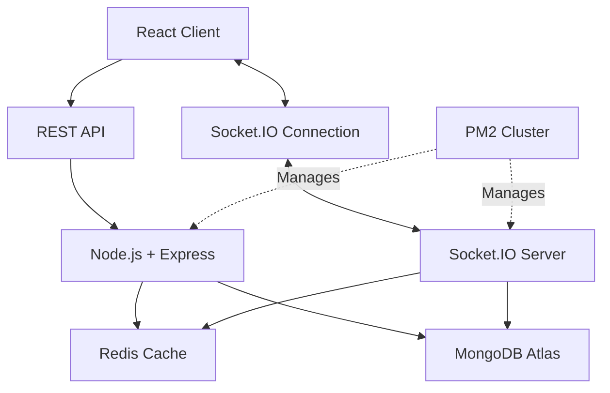

# Vibe — Hyperlocal Real-Time Community Rooms

A real-time, location-based discussion platform that helps users discover and join temporary community rooms within a **5 km radius**. Built with React, Node.js, Socket.IO, MongoDB, and Redis, Vibe focuses on low-latency communication and efficient backend performance.

## Key Features

- **Hyperlocal Discovery:** Discover discussion rooms within a 5 km radius.
- **Real-Time Messaging:** Exchange messages instantly using Socket.IO.
- **Temporary Rooms:** Rooms are designed to be ephemeral, with a maximum lifetime of 12 hours.
- **REST + WebSocket Architecture:** REST APIs handle room management and discovery, while WebSockets power real-time communication.
- **Redis Caching:** Cache frequently accessed data to reduce repeated database queries.
- **Rate Limiting:** Limit message frequency to reduce spam and abuse.
- **Scalable Backend:** Use PM2 clustering and MongoDB connection pooling to improve performance under concurrent load.

## Tech Stack

| Technology | Purpose |
|---|---|
| React.js | Frontend and user interface |
| Node.js | Backend JavaScript runtime |
| Express.js | REST API and request handling |
| Socket.IO | Real-time, bidirectional communication |
| MongoDB Atlas | Persistent data storage |
| Redis (Upstash) | Caching and rate limiting |
| PM2 | Process management and clustering |
| Artillery | Load testing |

## Architecture

Vibe uses a hybrid communication architecture that separates standard API requests from real-time messaging.



### Communication Flow

**1. Room Discovery**
- The client requests nearby rooms through REST APIs.
- The backend retrieves eligible rooms using the application's location filtering logic.
- Redis serves cached results when available; otherwise, the backend queries MongoDB.

**2. Real-Time Messaging**
- The client establishes a Socket.IO connection with the backend.
- Users join rooms through Socket.IO events.
- When a user sends a message, the server processes it and broadcasts it to connected users in the corresponding room.

**3. Data Storage and Caching**
- MongoDB stores persistent application data.
- Redis reduces repeated database reads and supports rate limiting.
- MongoDB connection pooling allows database connections to be reused across operations.

## Performance Optimization

One of the main challenges was improving backend performance under concurrent load.

Initial load testing revealed:

- A **14% error rate**.
- A p95 response time of approximately **4,770 ms**.
- MongoDB connection contention.
- Socket.IO transport configuration errors.
- A single-process bottleneck.

### Optimizations Implemented

**1. Redis Caching**

Cached frequently accessed room data to reduce repeated MongoDB queries.

- MongoDB queries reduced from approximately 5,000 to 250.
- Reduced database pressure for repeated reads.
- Improved the efficiency of room discovery requests.

**2. MongoDB Connection Pooling**

Configured connection pool settings to reuse database connections rather than repeatedly opening new connections.

- Reduced connection management overhead.
- Improved database access under concurrent requests.
- Tuned connection pool limits to manage database concurrency.

**3. PM2 Clustering**

Enabled PM2 cluster mode to run multiple Node.js worker processes.

- Improved utilization of available CPU cores.
- Increased the application's capacity to process concurrent requests.
- Enabled multiple workers to handle incoming traffic.

**4. WebSocket Transport Configuration**

Aligned client and server transport settings to use WebSocket-only communication, eliminating polling fallback attempts that conflicted with the server configuration.

### Load Testing Results

Load testing with Artillery was used to evaluate the application under concurrent workloads.

| Metric | Before Optimization | After Optimization |
|---|---:|---:|
| p95 response time | 4,770 ms | 32 ms |
| Observed error rate | 14% | 0% |
| MongoDB queries | ~5,000 | ~250 |
| Concurrent virtual users | Load-dependent | 1,000+ |

**Results:**
- Reduced p95 response time from **4,770 ms to 32 ms**, approximately a 149× improvement.
- Reduced MongoDB queries by approximately **95%**.
- Achieved a 0% observed error rate in the optimized load test.

*Note: Results represent the tested workload and configuration. Response latency and error rates depend on the test scenario and deployment environment.*

## Getting Started

### Prerequisites

Install the following before running the project:

- Node.js and npm
- MongoDB Atlas account or a local MongoDB instance
- Redis instance, such as Upstash Redis

### Installation

**1. Clone the repository**

```bash
git clone https://github.com/ROHAN-089/vibe.git
cd vibe
```

**2. Install dependencies**

Install dependencies in the frontend and backend directories according to the repository structure.

```bash
cd backend
npm install
```

```bash
cd ../frontend
npm install
```

*If your repository uses different directory names, replace `backend` and `frontend` with the actual directory names.*

**3. Configure environment variables**

Create the appropriate `.env` files for the backend and frontend.

Typical backend configuration:

```env
PORT=5000
MONGODB_URI=your_mongodb_connection_string
REDIS_URL=your_redis_connection_url
CLIENT_URL=your_frontend_url
```

Use the actual environment variable names expected by your application. Never commit database credentials, Redis URLs containing secrets, or other sensitive environment values.

**4. Start the backend**

```bash
cd backend
npm run dev
```

**5. Start the frontend**

In a separate terminal:

```bash
cd frontend
npm run dev
```

The exact startup commands depend on the scripts defined in each `package.json`.

## Load Testing

Artillery was used to simulate concurrent virtual users and measure application performance.

The load-testing workflow focused on:

- Request success and failure rates.
- p95 and p99 response latency.
- Database query volume.
- Connection stability.
- Performance before and after optimization.

For reproducible results, use the load-test configuration included in the repository, if available, and document the test duration, request mix, concurrency profile, and deployment configuration.

## Future Improvements

- Add authentication and stronger room access controls.
- Improve location-based queries with geospatial indexing.
- Introduce a Redis-backed Socket.IO adapter for cross-worker message broadcasting where required.
- Add comprehensive monitoring with Prometheus and Grafana.
- Improve automated testing and performance regression checks.

## What I Learned

Building Vibe provided practical experience with:

- Designing real-time applications using WebSockets.
- Combining REST APIs with event-driven communication.
- Implementing caching and understanding cache invalidation.
- Managing MongoDB connections under concurrent workloads.
- Using PM2 for Node.js process management.
- Identifying performance bottlenecks through load testing.
- Measuring the impact of backend optimizations using latency and error-rate metrics.

## Author

**Rohan Chargotra**
